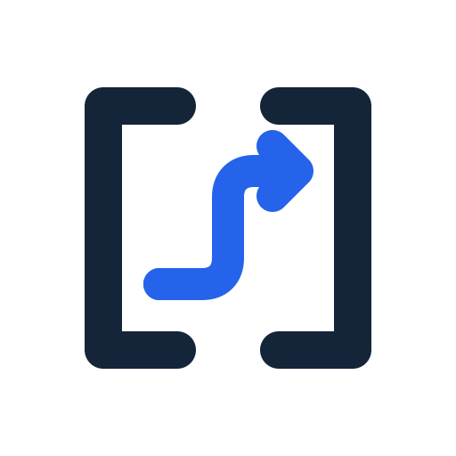

<p align="center">
  
</p>

<h1 align="center">Actspan</h1>

<p align="center">
  <strong>An open-source AI assistant for completing multi-step tasks in your real browser.</strong>
</p>

<p align="center">
  Search the web, interact with pages, extract information, and fill forms in plain language.
</p>

<p align="center">
  <a href="./README.md">中文</a> | English
</p>

<p align="center">
  <a href="https://github.com/youxing-max/ActSpan/blob/main/LICENSE">
    
  </a>
</p>

---

Actspan is an AI browser assistant that runs in Chrome. Describe a goal and it can break the task down, call browser tools, work across sites, and bring back an organized result. High-risk actions can pause for your confirmation.

It is more than a chat window that answers questions. Actspan is an execution layer for browser work: it uses the pages you are already signed into, handles real DOM and network interactions, and keeps the task flow and results in your browser.

## What It Is Good For

- **Research** — Search across sites, read pages, extract tables and key fields, and return structured findings.
- **Repetitive browser work** — Open sites, filter content, copy data, take screenshots, download files, or fill forms.
- **Site automation** — Record a recurring task once and run it again with a natural-language request.
- **Team notifications** — Push a completed investigation summary to configured Feishu / Lark or DingTalk bot webhooks.
- **Two-way DingTalk group bot** — Receive @mentions over DingTalk Stream mode, run browser tasks, and reply in the same conversation without a public callback URL.
- **Two-way Feishu / Lark bot** — A standalone long-connection connector for private chats and group @mentions.
- **Local and custom capabilities** — Connect the model service you choose, or extend Actspan through MCP and dynamic tools.

## Core Capabilities

### Execute in Your Real Browser

Actspan runs as a Chrome extension and reuses the login sessions already present in your browser. There is no cookie migration or re-login for every site; with your authorization, the assistant can read, click, type, navigate, and take screenshots in the current page.

### Natural-Language Agentic Loop

After you state a goal, the background Agentic Loop selects tools and works through multiple turns. Code owns permissions, boundaries, task isolation, and message transport; the model handles intent, next-step decisions, and result organization.

### Record and Reuse Workflows

Demonstrate a browser task once to record it. Actspan cleans up recording noise and turns the result into a reusable workflow. Workflows use declarative JSON, so common site tasks do not require a full custom extension.

### Tools and Protocol Extensions

- Browser tools for page interaction, navigation, tabs, screenshots, DOM/CSS, storage, and network diagnostics.
- Standardized tool registration and invocation through MCP.
- Dynamic HTTP tools and remote Manifests for connecting existing services.
- Feishu / Lark and DingTalk bot webhooks for completed-task results and other notifications.
- A DingTalk Stream-mode bot that accepts @mentions in group chats and replies with task results.
- A standalone Feishu / Lark long-connection bot for private chats and group @mentions.

### Choose Your Model

Actspan works with OpenAI-compatible model services, including cloud APIs and local deployments such as Ollama and LM Studio. You configure the API Endpoint, API Key, and model name; the project does not lock you to a specific provider.

## Privacy and Security Boundaries

- The extension and browser automation logic run locally in Chrome.
- Requests go to the model Endpoint configured in Options; Actspan does not host a model service for you.
- Page content, login sessions, and tool permissions should be used only for the task at hand. Do not expose sensitive pages to untrusted models or tools.
- Actspan supports human confirmation for sensitive actions so you can review and reject an operation before it runs.
- API configuration is stored in Chrome local storage; no separate Actspan account is required.

## Quick Start

### Install a Release

1. Open the [download page](docs/en/download.md) and download the latest extension archive.
2. Extract it and open `chrome://extensions/` in Chrome.
3. Enable **Developer mode**, click **Load unpacked**, and select the `actspan-extension/` folder.
4. Right-click the Actspan extension icon, open **Options**, and enter your model Endpoint, API Key, and Model.
5. Open any webpage and press `Ctrl+M` (Windows/Linux) or `Cmd+M` (macOS) to summon the assistant.

### Build from Source

```bash
git clone https://github.com/youxing-max/ActSpan.git
cd ActSpan
npm install
npm run build
```

After the build completes, load `build_version/actspan-extension/` in Chrome. See the [Getting Started Guide](docs/en/guide/getting-started.md) for the complete installation and configuration flow.

## Example Requests

On any webpage, try:

```text
Summarize this page and list the key conclusions with supporting evidence.
Search this site for matching products and organize the top five results.
Read this table and extract the names, email addresses, and amounts.
When the investigation is complete, send the summary to the “Investigation Results” webhook.
```

## How It Works

```text
Your goal
   ↓
Background Agentic Loop: understand → select tools → execute and verify → organize
   ↓
Browser pages / workflows / MCP tools / webhooks
   ↓
Floating ball, session history, and notifications
```

Actspan uses a layered Chrome Extension Manifest V3 architecture:

| Layer | Responsibility |
|---|---|
| Content Script | Floating-ball UI, page interaction, and page-side events |
| Background | AI orchestration, task lifecycle, tool dispatch, and notifications |
| Channel | Messaging between Content Script, Background, and the external MCP server |

## MCP and External Tools

The repository includes a local MCP Server that exposes Actspan browser capabilities to MCP-compatible clients. Stable tools cover status, tabs, page reading and interaction, workflow execution, task queries, and the `actspan_feishu_push` notification tool.

See [MCP Bridge](MCP-BRIDGE.md) for configuration, authentication, tool parameters, and end-to-end tests.

## Documentation

- [Documentation home](docs/en/index.md)
- [Getting Started](docs/en/guide/getting-started.md)
- [Examples](docs/en/guide/examples.md)
- [Workflows](docs/en/guide/workflows.md)
- [Configuration](docs/en/guide/configuration.md)
- [MCP Bridge](MCP-BRIDGE.md)

## Development

```bash
npm run dev          # Watch builds
npm run build        # Build Popup, Content, Sidepanel, and Background
npm test             # Run Node tests
npm run lint         # Run lint checks
npm run docs:dev     # Preview the documentation site locally
```

## License

[AGPL-3.0](LICENSE)
